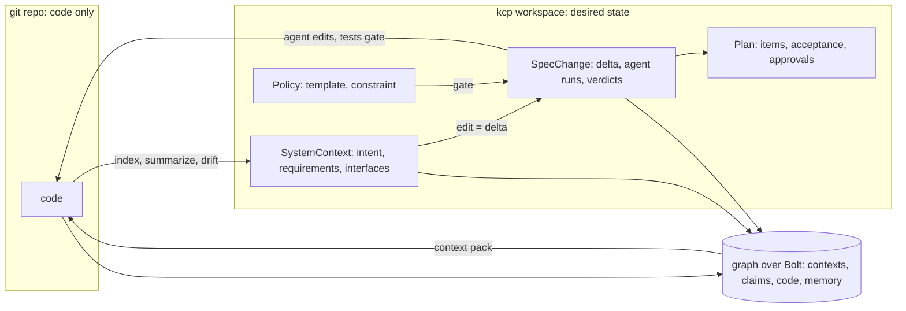
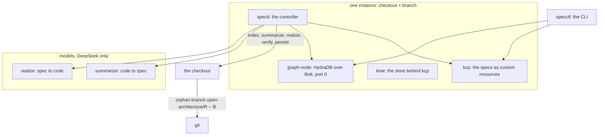

# graph-clm-kcp-spec

Two-way sync between code and specs. kcp holds the specs. A controller keeps
the code and the specs equal. A graph database indexes both. A language model
reads a small neighborhood of the graph, not a large document.

## What it does

- **Code to spec.** The controller indexes a repository with CodeGraph. A model
  writes each context's intent, requirements and interfaces. Every claim cites
  code.
- **Spec to code.** A person or a model edits a spec. The controller computes a
  delta. An agent edits the code. The repository's tests gate the commit.
- **Policies.** A policy is a rule over the specs, the code and the changes. A
  policy blocks a bad change or reports it.



## How it works

An **instance** is one checkout and one branch. An instance has its own kcp,
kine and HydraDB graph-node. Every listener binds port 0. The kernel assigns the
port. The state stays outside the project tree.



A **context** is one part of the system. The partitioner makes one context per
Go package, per deno workspace member and per cargo crate. It also makes one
context per command. A context holds intent, requirements, interfaces,
interactions and code refs. A context's `dependsOn` comes from production
imports. Test imports become `TEST_IMPORTS`.

A **claim** is one unit: the intent, a requirement, an interface, an
interaction. A unit is *declared* when a person, a plan or a model wrote it. A
summary keeps declared units and records what it would have written as a
proposal. Only a person, a plan or a released unit lets a removal through.

## Install

```bash
# tools on PATH: go 1.26+, kcp v0.33, kine, kubectl, codegraph, git
git clone <this repo> && cd graph-clm-kcp-spec
make build          # bin/specctl, bin/specd, bin/graph-node (+ bin/lib), no root
export PATH="$PWD/bin:$PATH"
```

## Quick start

Start an instance on any repository. Use a worktree, so the architecture
branches stay out of your everyday checkout.

```bash
export REPO=$HOME/.tmp/myrepo
git clone https://example.com/someone/project.git "$REPO" && cd "$REPO"
git switch -c specs/try

specctl up --summarize=false --remote ""   # kcp, kine and graph on port 0; index and partition
specctl status                             # kcp, graph, specd, populate progress
specctl arch outline                       # every context: upstream, requirements, conditions
specctl down                               # stop specd, kcp, kine and the graph
```

Add model summaries and the realize agent:

```bash
specctl up --agent claude-mod --remote ""  # DeepSeek writes intent, requirements, interfaces
```

## The code to spec loop

```bash
specctl ingest --repo . --summarize --agent claude-mod   # a specd must be running
specctl get systemcontexts -o yaml                        # what kcp holds now
specctl arch outline -o json > ~/.tmp/outline.json        # the same, for a program
```

The controller raises a `CodeToSpec` change when the code drifts from the spec.
It raises one when a context has no intent yet. `specctl get specchanges` lists
them.

## The spec to code loop

A context document is the model's view of one context. The tool owns the top.
The model owns the bottom.

```bash
specctl clm render --context impl-ingest > ~/.tmp/ctx.md
$EDITOR ~/.tmp/ctx.md                       # edit the prose and the `yaml spec` block
specctl clm apply --context impl-ingest < ~/.tmp/ctx.md
specctl get specchanges                     # Pending, Running, Succeeded
specctl arch proposals                      # what a summary would change in a declared unit
specctl clm report --change <name> --turn 3 --tool Edit --file impl/ingest/ingest.go
```

`specctl clm apply` computes a delta. The controller opens a `SpecToCode`
change. The realize agent edits a worktree. `go build`, `go vet` and the tests
of the changed packages gate the commit. `specctl accept` runs the repository's
acceptance steps against the tree.

```bash
specctl accept                              # the Repository's acceptance steps
specctl accept --override <step> --reason "landing the fix"   # one-shot override
specctl retry --reason "the flake is fixed" impl-ingest       # the next attempt
```

Declare and release units:

```bash
specctl arch declared impl-ingest                       # units a person wrote
specctl arch declare impl-ingest --unit requirement/r.pack-order
specctl arch release impl-ingest --unit requirement/r.old   # let the summary write it
```

## Plans, findings and agent runs

A **Plan** is work over time: items, staged spec edits, acceptance commands and
dependencies. Nothing runs before a person approves the plan.

```bash
specctl plan apply -f docs/plan.yaml        # stage; - reads stdin
specctl plan preview p0013                  # each item's delta, writes nothing
specctl plan approve p0013                  # a person approves
specctl plan show p0013                     # item table: phase, commit, acceptance
specctl plan items --context impl-ingest    # unfinished items that touch a context
specctl plan status p0013 --all-instances   # one row per item per instance
```

A **Finding** is one defect or proposal worth a decision.

```bash
specctl finding add --context calc --unit requirement/r.add --summary "the code returns a stale sum" --source review
specctl finding ls
specctl finding dismiss <name> --reason "duplicate"
```

An **AgentRun** is one model call: purpose, change, phase, duration.

```bash
specctl get agentruns -o table
```

## The context pack and the graph

A pack is what a model gets for one task. The order is fixed, so the prefix of
the prompt stays cacheable. The model zone is last: it is the only part a model
edits.

```bash
specctl context pack --context impl-ingest
specctl context pack --file impl/ingest/ingest.go
specctl context pack --query "depends on production imports"
specctl arch owner impl/ingest/ingest.go    # the context that owns a path
```

The pack holds, in order: the repository card, the task card (the verify and
acceptance commands), the owner context card, the ranked neighbor cards, the
blackboard and the scoreboard, the open findings, proposals and plan items, a
token-budget line, then the model zone.

Query the graph. One hop only; HydraDB refuses longer patterns.

```bash
specctl graph query 'MATCH (c:SpecContext) RETURN count(*) AS contexts'
specctl graph query 'MATCH (a:SpecContext {name: "impl-ingest"})-[:DEPENDS_ON]->(b:SpecContext) RETURN b.name AS name'
specctl graph neighbors impl-ingest
specctl graph search "production imports partition"
specctl graph rebuild                       # rewrite the graph and refill the search index
```

Serve a graph of its own and load a saved one. Every change persists the graph
to the orphan branch as `graph/vertices.jsonl` and `graph/edges.jsonl`.

```bash
specctl graph serve --root ~/.tmp/graph-inspect > ~/.tmp/graph.env
. ~/.tmp/graph.env
specctl graph load --ref open-architecture/myrepo--specs-try
specctl graph query 'MATCH (m:Memory) RETURN count(*) AS memories'
specctl graph stop --root ~/.tmp/graph-inspect
```

## Memory

A model writes notes in the model zone. Each note becomes a Memory vertex,
linked to the code and the claim units it names.

```bash
specctl clm remember --context impl-ingest --title "pack order" --body "the order keeps the prefix cacheable"
specctl clm recall "pack order"
specctl clm neighbors impl-ingest
```

## Policies

A policy is a Gatekeeper `ConstraintTemplate` plus constraints. A policy reads
the spec objects, the graph and the diff. Policies live on the orphan branch
`open-policy/<repository>`.

```bash
specctl policy ls                           # what kcp holds
specctl policy new relay-only-ssh           # scaffold a template
specctl policy build --dir .                # compile templates into dist/
specctl policy test --dir .                 # opa unit tests and gator suites
specctl policy eval --repo . --commit HEAD  # audit a commit, no controller needed
specctl policy report                       # the last audit
specctl policy generate --repository atproto-market --slug relay-only --sentence "every ssh to a guest goes through the relay"
specctl policy accept <name>                # commit a proposed policy to its branch
specctl policy kcp apply --dir .            # apply a library into kcp
```

Two policy sets ship in `policies/packs/`: `rfp-guest-isolation` (the host never
reaches into a guest; the guest reports its own network) and
`rfp-provisioning-provenance` (a guest transport and its keys come from the
guest's `user_data`). `policies/library/` holds the portable library.

## Persistence

The specs, the graph and the policies go to orphan branches. They are written
with git plumbing and never checked out. The project tree holds code only.

```bash
git log --oneline 'open-architecture/*'     # every spec change
git log --oneline 'open-policy/*'           # every policy change
git show open-architecture/myrepo:specs/calc.yaml
specctl persist --remote origin             # write kcp to the branch and push
specctl restore --remote origin             # rebuild kcp from the branch
specctl sync                                # merge a reviewed branch edit into kcp
```

A clone whose `origin` carries `open-architecture/<repository>` restores the
specs from it. Nothing is pushed unless `--push` or `persist --remote` asks.

## Configuration

A CLI reads `cli-args-env.json` for every option and an optional `config.json`
for values. The order is: flag, then the option's environment variable, then
`config.json`, then the default.

```json
{ "name": "specd", "options": { "resync": { "type": "string", "env": "SPECD_RESYNC", "default": "5s" } } }
```

Point a CLI at another `config.json` with `CONFIG_PATH_<NAME>`, where `<NAME>` is
the CLI directory in upper case with `_` for `-`
(`hono-http-static` becomes `CONFIG_PATH_HONO_HTTP_STATIC`).

Environment variables that matter:

| Variable | Meaning |
| --- | --- |
| `SPECD_STATE_DIR` | instance state: kcp, kine, graph, logs, context documents |
| `SPECD_KUBECONFIG`, `SPECD_WORKSPACE`, `SPECD_NAMESPACE` | the kcp target |
| `SPECD_BOLT_URL`, `SPECD_BOLT_USER`, `SPECD_BOLT_PASSWORD_FILE` | an external graph |
| `SPECD_GRAPH_NAMESPACE` | namespace inside a shared graph |
| `SPECD_MAX_INSTANCES` | how many kcp instances this host runs at once |
| `SPECD_CLM_CONTEXT`, `SPECD_CLM_DOC`, `SPECD_CLM_ROOT` | the CLM document of a session |

## Models

Evals and live model tests use DeepSeek only:

- `--agent claude` and `--agent claude-mod` run `deepseek-claude` (headless
  `claude -p`). `claude-mod` also loads `cc-clm-mod`.
- `--agent pi` runs the pi coding agent with `--provider deepseek`.
- `--agent scripted:<file>` replays a YAML scenario. No model, no network.

No local model. A measurement against a local model describes that model, not
this system.

## Tests

```bash
make test          # unit tests; live tests skip in short mode
make check         # gofmt and go vet
make test-live     # SPECD_REQUIRE_LIVE=1, -p 6 -timeout 45m: every live package
                   # each package starts its own kcp and graph-node on port 0
SPECD_GRAPH_NAMESPACE=probe-1 make test-live   # the same, under another namespace
```

`test/e2e` runs 50 live tests in parallel, each in a workspace of its own. One
run takes about two minutes. `SPECD_MAX_INSTANCES` caps kcp instances host-wide;
a start waits for a free slot. Stop instances you start: `specctl down`.

## Layout

| Path | Contents |
| --- | --- |
| `abc/` | pure types and state: spec, delta, sync, plan, authority, clm, contextpack, search, graph, policy. No I/O. |
| `common/` | leaf utilities: `specapi` (kinds, GVRs, conditions), `yamlx`, `glob`, `ids` |
| `impl/` | I/O: `kcpclient`, `kcpproc`, `graphproc`, `boltgraph`, `ingest`, `populate`, `summarize`, `realize`, `persist`, `searchindex`, `contextpack`, `policyeval`, `policygit`, `eval`, `claudecli`, `piagent` |
| `factory/` | `specd`, the controller, composed from `impl` |
| `cmd/` | `specctl`, `specd`, `hydradb-bins` |
| `cc-clm-mod/` | the Claude Code mod: context document, owner cards, task card, arch tools |
| `clm/`, `pi-hydradb-clm/` | the shared CLM core and the pi host |
| `policies/` | the policy library and the packs |
| `fixtures/` | sample repositories used as input and in tests |
| `deploy/`, `examples/`, `test/` | manifests, example policy sets, repository-wide tests |

deps flow one way: `common` <- `abc` <- `impl` <- `factory` <- `cmd`.

## State and ports

| State | Where | Owner |
| --- | --- | --- |
| kcp, kine and the graph | `$SPECD_STATE_DIR/repos/<repo>-<hash>/<branch>/` | `specctl up`, `specctl kcp start`, a test |
| specs, plans, findings, policies | orphan branches, written with git plumbing | the controller |
| context documents | `$SPECD_STATE_DIR/clm/` | the CLM host |
| search index | `<kcp root>/search.db` | `specctl graph rebuild` |

Every listener binds port 0 and reports the bound port: kcp and kine into
`<root>/endpoint.json`, the graph into `<root>/graph/graph.json` and into
`Repository.status.graph`. Only edge entry points keep a known address.

## Limits

- **One architecture branch per repository.** Every checkout of a repository
  shares `open-architecture/<repository>--<branch>`. A worktree does not get a
  branch of its own.
- **A pack reports pack tokens, not model tokens.** No model-usage accounting
  exists; the token line is the pack's own estimate.
- **The graph runs the portable Cypher subset.** HydraDB refuses `type(r)`,
  `WITH` filters, bare node returns, regex, null parameters and an edge whose
  endpoint vertex is absent. Ranking therefore runs in Go, over one-hop reads.
- **A skill text is versioned but not evolved.** Every host injects one versioned
  context-management skill. No loop searches for a better one yet.
